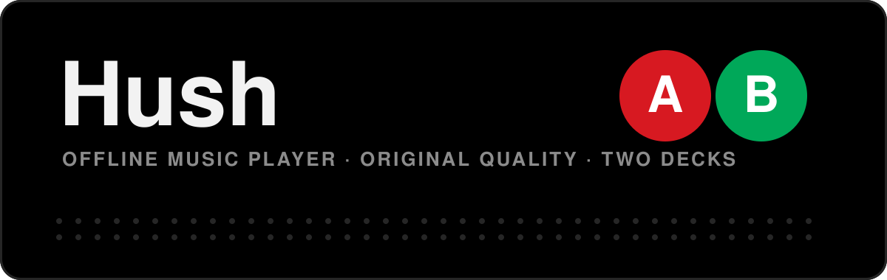

  

  
  
  

<b>A minimal, true-black music player for your own files. Nothing-phone dots. NYC-subway bullets. Braun-style widget.</b>

---

## Get it

1. Tap **Download Hush.apk** above, on your phone.
2. Open the file. If Android asks, allow installs from your browser.
3. Open Hush and allow music access.

Updates install over the old version. Every push to `main` rebuilds the same download link.

## What it does

| | |
|:--|:--|
| **Original quality** | FLAC, WAV, AIFF, MP3, AAC and more, played exactly as stored. |
| **Own volume** | Hush has its own volume, separate from the phone. Phone at 100%, Hush at 20%. |
| **Two decks, A and B** | Play two things at once. Each deck has its own song, speed, volume and colour. Switch with the subway bullets. |
| **Background play** | Screen off, app closed, still playing. Bluetooth and headset buttons work. |
| **Your library, your way** | Hold a song to drag it into place, or edit its name, artist and cover. Your files are never touched. |
| **Speed + sleep timer** | 0.5x to 2x, and a timer that pauses both decks. |
| **Braun widget (1x1)** | Swipe up and down to change deck, tap to play or pause. |
| **Zero internet** | There is no internet permission in the app. It cannot use data or Wi-Fi. |
| **Light on battery** | Audio offload when the screen is off, no wake-ups when idle, almost no animation. |

## Design

True-black OLED, thin lines, one accent colour per deck (pick your own), big blocky controls.

## Build it yourself

Fork this repo and push. GitHub Actions builds the APK and publishes it to the **latest** release.

Kotlin · Media3 · Android Views · no Compose · no network

---

<b>Made with love by Divakar and Claude</b>

